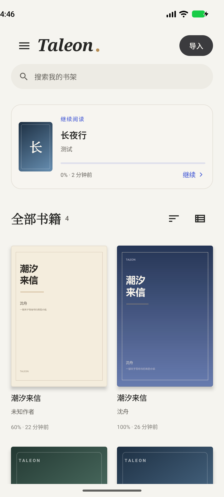
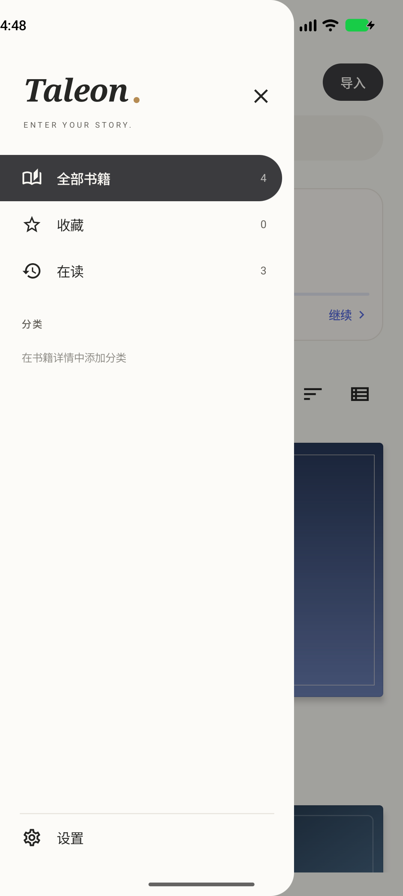
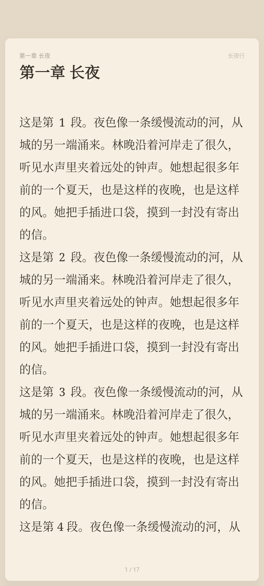
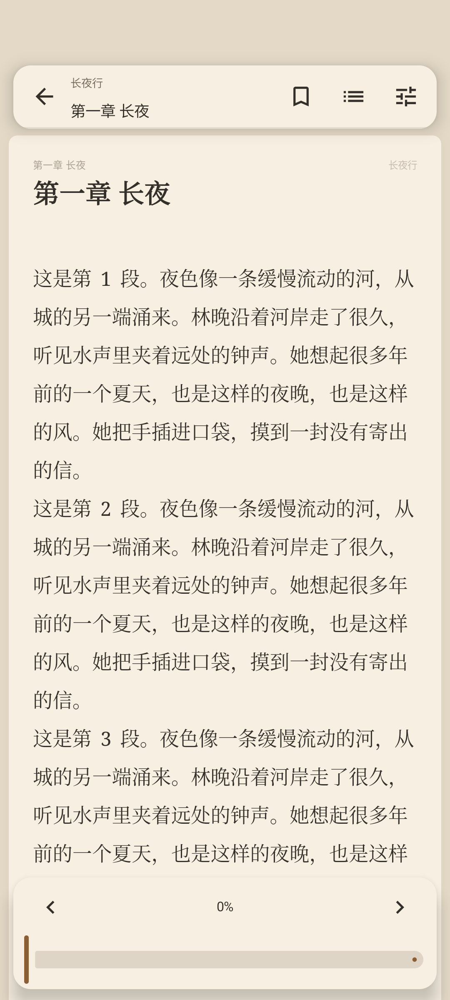
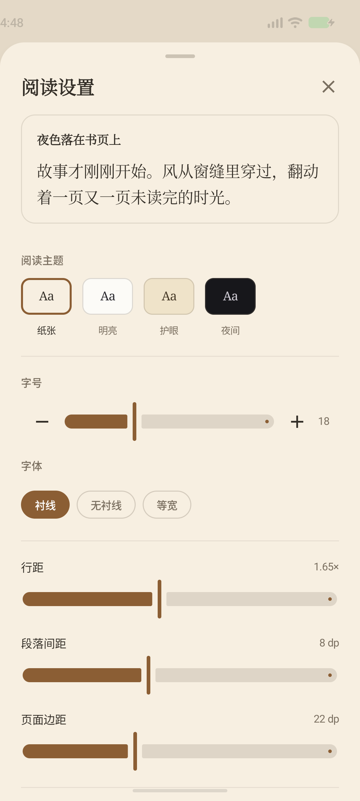

# Taleon

**Enter Your Story.**

当前版本：**1.1.0** · Android 8.0+

Taleon 是一款原生 Android 小说与电子书阅读器，使用 Kotlin、Jetpack Compose 和 Material 3 构建。它把阅读体验放在第一位：离线、无账号、无广告，数据只保存在本机。

书架与阅读器的信息层级参考了开源阅读器 [Koodo Reader](https://github.com/koodo-reader/koodo-reader) 的整理方式：中性底色、大封面网格、无边框列表、侧边书架导航、书页式阅读区和悬浮工具栏。Taleon 未复制 Koodo Reader 的源代码或图像素材，品牌、配色和实现均为独立设计。

| 书架 | 书架导航 |
| --- | --- |
|  |  |

| 阅读页 | 阅读工具栏 |
| --- | --- |
|  |  |

| 阅读设置 |
| --- |
|  |

## 已实现功能

### 书架

- 真实数据源：所有书籍来自 Room 数据库，不使用示例书籍冒充正式内容。
- 网格与无边框列表两种视图，按最近阅读、添加时间、书名、作者排序。
- 书籍卡片不显示文件格式标签，保持与 Koodo Reader 一致的信息层级。
- 侧边书架导航：全部书籍、收藏、在读、分类。
- 继续阅读卡片，显示真实阅读进度与最近阅读时间。
- 书名、作者、文件名搜索。
- 单本或批量导入 TXT / EPUB / PDF，支持 SAF 文件选择。
- 基于 SHA-256 文件内容哈希的重复导入检测。
- 导入时复制文件到应用私有目录，原文件被移动或删除后仍可阅读。
- EPUB 内嵌封面提取，PDF 首页封面渲染；无封面时生成稳定的默认封面。
- 收藏、分类、删除书籍；删除同时清理文件、封面、进度和书签。
- 导入进度、成功/重复/失败汇总，以及可读的错误原因。
- 空书架、搜索无结果、加载和文件缺失状态。

### 阅读器

- 翻页与滚动两种阅读方式。
- 基于 `StaticLayout` 的真实分页：综合字号、字重、字体、行距、段距、页边距和可用宽高计算。
- 参数变化后重新排版，并用章节索引 + 字符偏移尽可能恢复原位置。
- 书页式阅读画布：页边、圆角、阴影、章节/书名页眉与页码页脚。
- 浮动式工具栏：返回、书签、目录、阅读设置与底部进度滑杆。
- 点击左右区域翻页，点击中间显示/隐藏工具栏，支持左右滑动翻页。
- 目录跳转，目录标记当前章节与字数。
- 书签添加/移除；书籍详情中查看、跳转、删除书签。
- 阅读进度节流写入 Room；暂停、退出和 ViewModel 清理时兜底保存。
- 阅读时长统计与“读过的书”数量。
- 音量键翻页、屏幕常亮。
- 阅读主题：纸张、明亮、护眼、夜间。
- 字号、衬线/无衬线/等宽字体、行距、段落间距、页面边距实时调整。
- 翻页动画：滑动、淡入、无动画。
- 沉浸式系统栏，适配横屏、刘海和安全区域。
- PDF 使用系统 `PdfRenderer` 逐页渲染，支持缩放、平移、页码跳转，并保存页码进度。

### 格式支持

| 格式 | 能力 | 已知限制 |
| --- | --- | --- |
| TXT | BOM、UTF-8、UTF-16、GB18030 检测；章节识别；分页/滚动；大章节切分 | 单文件上限 48 MB；极少数无空格、无换行的纯 CJK UTF-16 文件可能无法自动判定编码 |
| EPUB | EPUB 2/3 元数据、spine 阅读顺序、目录（nav/NCX）、封面、XHTML 正文重排 | 不渲染复杂 CSS、内嵌字体与正文图片；以文本重排为目标，不宣称完整版式还原 |
| PDF | 系统引擎逐页渲染、缩放、平移、页码跳转、进度保存 | 暂不支持 PDF 文本选择与全文搜索；加密/损坏文件会给出错误提示 |

## 技术栈

- Kotlin 2.2.21
- Jetpack Compose + Material 3（Compose BOM 2025.10.01）
- Navigation Compose
- Room 2.8.1 + KSP
- Preferences DataStore
- Kotlin Coroutines / StateFlow
- Android Storage Access Framework
- Jsoup（EPUB XHTML/XML 解析）
- JUnit 4、Robolectric、Compose UI Test
- AGP 8.13.2 / Gradle 8.13 / compileSdk 36 / minSdk 26 / targetSdk 36

## 架构

```text
app/src/main/java/com/taleon/reader/
  data/
    files/        TXT/EPUB/PDF 解析、编码检测、文件复制与封面
    local/        Room 实体、DAO、数据库与映射
    repository/   书籍导入、打开、进度、书签、统计
    settings/     DataStore 偏好
  domain/model/   书籍、章节、进度、书签、设置等领域模型
  ui/
    library/      书架、搜索、排序、导入
    details/      书籍详情、分类、书签、删除
    reader/       分页、阅读页 View、阅读器、目录、设置
    settings/     应用与默认阅读设置
    theme/        Material 3 配色、排版、阅读主题
    components/   封面、书籍卡片、通用状态组件
```

关键约束：

- UI 不直接访问数据库或文件。
- 解析与分页在 IO / Default 调度器执行，主线程只负责渲染。
- 阅读位置使用章节索引 + 字符偏移，不依赖“页码”恢复。
- 分页与绘制共用同一套 `StaticLayout` 规则，避免页边界与显示不一致。
- 导入结果、文件缺失、编码失败和解析失败都有明确错误路径。

## 构建

要求：

- JDK 17 或更高（本项目在 Temurin 21.0.12.1 上验证）
- Android SDK Platform 36
- Android Build-Tools 36.0.0

`local.properties` 示例：

```properties
sdk.dir=/path/to/Android/Sdk
```

命令：

```bash
./gradlew :app:assembleDebug
./gradlew :app:testDebugUnitTest
./gradlew :app:assembleDebugAndroidTest
./gradlew :app:connectedDebugAndroidTest
./gradlew :app:lintDebug
```

生成的 APK：

```text
app/build/outputs/apk/debug/app-debug.apk
```

> Windows 中文路径说明：Gradle 在非 ASCII 项目路径下可以完成编译和 APK 构建，但本机的 Test Worker 无法加载测试类。本次测试通过指向仓库的 ASCII junction（`C:\taleon-build`）执行，源码与产物未做任何复制或修改。项目中的 `android.overridePathCheck=true` 用于允许中文路径构建。

## 本次实际验证

在 Android Emulator `taleon`（Android 17 / API 37，x86_64）上：

- `:app:assembleDebug`：成功，生成 `app-debug.apk`
- `:app:testDebugUnitTest`：17 个单元测试通过
- `:app:connectedDebugAndroidTest`：1 个 Compose UI 测试通过
- `:app:assembleDebugAndroidTest`：成功
- `:app:lintDebug`：成功，0 errors（保留若干弃用/国际化类 warning）

单元测试覆盖：

- UTF-8 / GB18030 / UTF-16 BOM / 无 BOM UTF-16 解码
- TXT 元数据、章节拆分、前言、Windows 换行、超长章节
- EPUB container / OPF / nav / spine / 正文提取 / 缺 container 错误
- `StaticLayout` 分页边界、空章节、字符偏移定位

UI 测试覆盖：

- 空书架状态和“导入第一本书”按钮可见、可点击

未执行：真实多品牌设备测试、超大 PDF/TXT 压力测试、TalkBack 全流程人工验收。

## 已知限制与后续计划

- EPUB 目前是“文本重排”实现，不渲染复杂版式、图片、CSS 和嵌入字体。
- PDF 暂不支持文本选择、全文搜索与标注。
- 尚未实现跨设备同步、云备份、导入进度跨进程恢复。
- 书架尚未提供拖拽排序和自定义封面。
- 统计只存在本机，尚未提供图表与按日明细。
- TXT 编码识别以 UTF-8 / UTF-16 / GB18030 为主；Big5 等编码可能被误判为 GB18030。
- 没有网络权限，因此也不会出现在线书城、账号或广告。

## 样例文件

`samples/` 中包含用于导入与分页验证的示例 TXT、EPUB、PDF。它们仅用于测试和演示，不属于应用内置数据。
